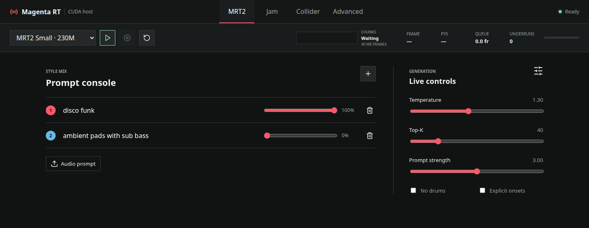
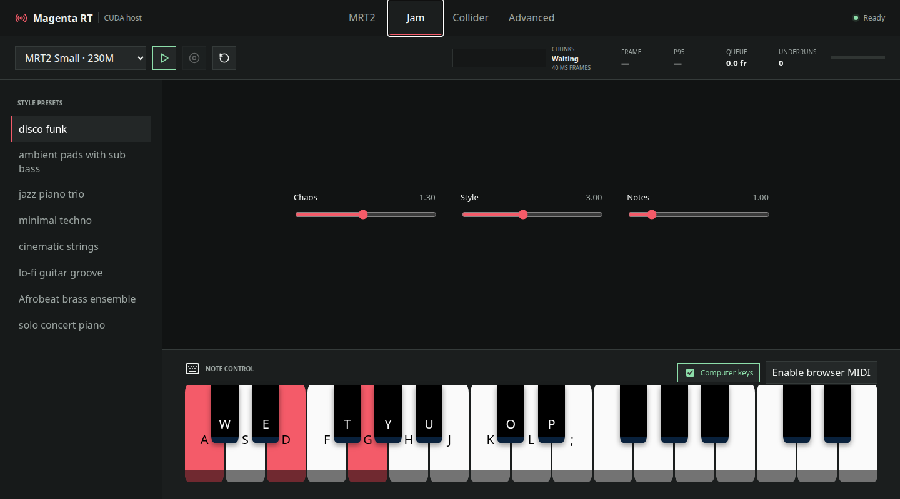
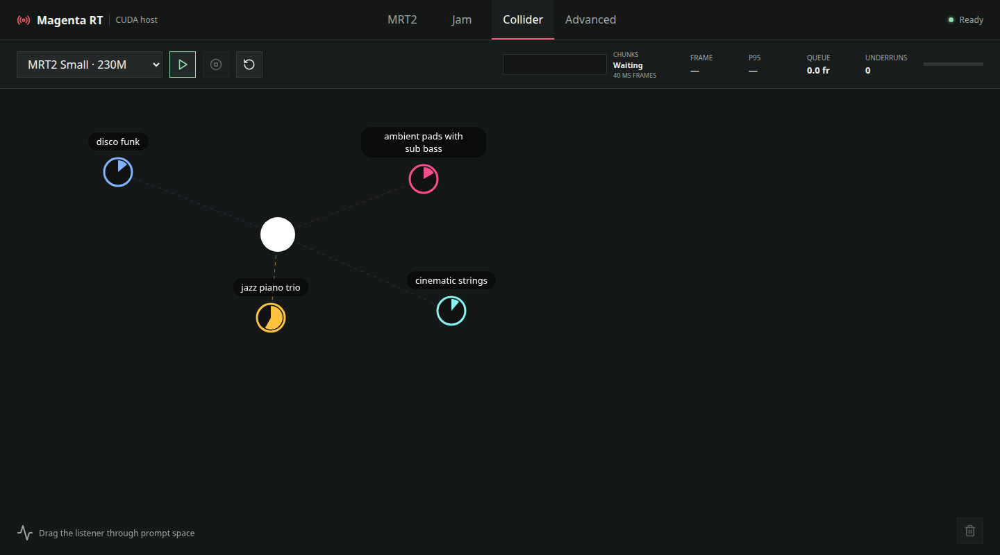
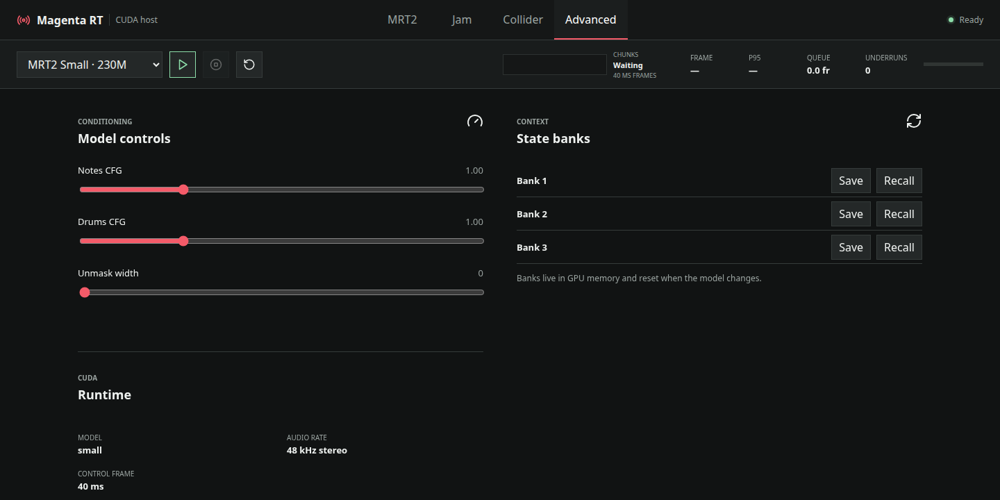

# Magenta RealTime CUDA

**Generate and steer music in your browser with Magenta RealTime 2 and CUDA inference.**

A focused CUDA edition of [Google DeepMind Magenta’s Magenta RealTime 2](https://github.com/magenta/magenta-realtime), with a React web interface and an isolated JAX inference worker. Mix text and audio style prompts, play notes, explore prompt space, and record 48 kHz stereo WAVs.

> This is an independent derivative project, not an official Google release. The MRT2 models, architecture, original inference runtime, MusicCoCa, SpectroStream, and shared UI components come from the [upstream project](https://github.com/magenta/magenta-realtime). See [attribution](#attribution-and-citation), [NOTICE](NOTICE), and [MODEL.md](MODEL.md).

## What you can do

- **MRT2:** blend up to six text or audio prompts and adjust generation controls while music plays.
- **Jam:** guide the music with an on-screen piano, your computer keyboard, or a browser MIDI input.
- **Collider:** move a listener among style prompts to change their mix interactively.
- **Advanced:** save and recall three model context banks, and inspect the active model and audio runtime.
- **Record:** capture the generated stream and download a stereo WAV.
- **Switch models:** choose the 230M Small or 2.4B Base checkpoint; the service releases the previous worker before loading the next.

## Explore the web UI

These screenshots show the running CUDA host in its Ready state with built-in style prompts.

| MRT2 — prompt mixing and live controls | Jam — styles, note controls, and piano |
| --- | --- |
|  |  |
| Collider — move through prompt space | Advanced — conditioning and context banks |
|  |  |

This repository contains the CUDA/JAX browser host. For the upstream apps, other backends, native plugins, and their documentation, visit [magenta/magenta-realtime](https://github.com/magenta/magenta-realtime).

## Quick start

### 1. Clone and install

```bash
git clone --recurse-submodules git@github.com:ZZDDD/magenta-realtime-CUDA.git
cd magenta-realtime-CUDA

python -m pip install -e ".[cuda,web]"

npm --prefix examples ci
npm --prefix examples run build
```

The public `sequence-layers` dependency is pinned as a git submodule. If you cloned without `--recurse-submodules`, run `git submodule update --init --recursive` before installation.

### 2. Download the model assets

Choose a directory outside the source tree. The commands below use `~/models/magenta-realtime-2` throughout:

```bash
mrt web download-assets \
  --asset-root "$HOME/models/magenta-realtime-2"

mrt web verify-assets \
  --asset-root "$HOME/models/magenta-realtime-2"
```

The downloader fetches the two CUDA checkpoints and shared resources from the [original Hugging Face model repository](https://huggingface.co/google/magenta-realtime-2) at a pinned revision. Verification checks file sizes and SHA-256 hashes. The model weights are separate downloads and are not stored in this Git repository.

If you already have these files, pass their existing root instead:

```text
magenta-realtime-2/
├── checkpoints/
│   ├── mrt2_base.safetensors
│   └── mrt2_small.safetensors
└── resources/
    ├── musiccoca/
    └── spectrostream/
```

### 3. Launch the web UI

```bash
mrt web serve \
  --asset-root "$HOME/models/magenta-realtime-2" \
  --model mrt2_small
```

Open **http://127.0.0.1:8000**. Wait for **Ready**, then click **Play**. First startup and first playback can take longer while the runtime compiles the model. Stop the service with **Ctrl+C**.

Use `--model mrt2_base` to select Base. Run `mrt web serve --help` for the available launch options. The service admits one controller session and binds to localhost by default. For remote access, forward the port through SSH or use an authenticated proxy.

## Your first session

1. In **MRT2**, keep `disco funk` or type a style such as `ambient pads with sub bass`. Give at least one prompt a nonzero weight.
2. Click **Play**. Raise or lower **Prompt strength** to change style adherence. **Temperature** changes randomness; **Top-K** limits how many next-token choices the model considers.
3. Add a second style and move the weight sliders to blend them. Use **Audio prompt** to upload a reference clip (up to 50 MiB).
4. Switch to **Jam** for note control. Use the piano with your pointer, or enable the computer keyboard: white keys are `A S D F G H J K L ;`, and black keys are `W E T Y U O P`. Choose **Enable browser MIDI** for a connected controller.
5. In **Collider**, drag the listener toward a prompt to give that style more weight. Edit and add prompts in the MRT2 view first.
6. Click **Record** while playing, then **Stop recording**. The **WAV** link downloads your take.

**Pause** stops generation while keeping model context. **Reset model state** starts a fresh musical history. Advanced context banks exist only in worker memory and reset when the model changes. Recordings and uploaded prompts are saved under the asset root in `recordings/` and `uploads/`.

## Measure performance

The model produces a 40 ms audio frame per step. Sustained generation must stay ahead of playback. The toolbar shows generation time, P95 time, queued audio, and underruns; the chunk monitor shows arrival timing.

Run a benchmark for the selected model:

```bash
mrt web benchmark \
  --asset-root "$HOME/models/magenta-realtime-2" \
  --models mrt2_small --devices 0
```

The report is written to `benchmarks/cuda-matrix.json` beneath the asset root. Use `mrt web benchmark --help` to choose the models and devices to measure.

To compare Base’s FP32 and BF16 paths, render both with:

```bash
mrt web compare-precision \
  --asset-root "$HOME/models/magenta-realtime-2" \
  --model mrt2_base --device 0 --frames 250
```

See [the CUDA guide](docs/cuda-web.md) for runtime behavior, asset management, and diagnostics.

## Troubleshooting

| Symptom | What to check |
| --- | --- |
| CUDA is unavailable | Install the `cuda` extra and follow [JAX installation guidance](https://docs.jax.dev/en/latest/installation.html). |
| `sequence_layers` import fails | Run `git submodule update --init --recursive`. |
| The browser says “frontend not built” | Run `npm --prefix examples ci` followed by `npm --prefix examples run build`. |
| Loading or first playback is slow | Watch the server terminal. JAX compiles on first use; compiled data is cached under `jax-cache/` in the asset root. |
| Model loading fails | Check the server error and run asset verification. Start with Small to check the complete workflow. |
| Audio stutters | Check frame/P95 time and underruns, use Small, and check the network connection. A 40 ms frame time is the real-time budget. |
| A second browser cannot control the app | Close the first controller tab; one active controller is supported. |
| No sound or MIDI | Click Play to unlock browser audio, check output volume, and use localhost or HTTPS. Web MIDI support varies by browser. |

## Source and checks

```bash
python -m pip install -e ".[cuda,web,dev]"
python -m pytest
npm --prefix examples run build
```

```text
magenta_rt/jax/         MRT2 inference runtime
magenta_rt/web/         CUDA worker, coordinator, protocol, benchmarks
magenta_rt/cli/         mrt web and mrt jax commands
examples/web/ui/       React browser application
examples/common/       Shared upstream piano and prompt-surface components
tests/                 Portable coordinator and protocol checks
```

## Attribution and citation

This work builds on [Magenta RealTime 2](https://github.com/magenta/magenta-realtime), copyright Google LLC, by Google DeepMind’s Magenta team and the upstream contributors. Credit for the original models, research, model runtime, codec, style embedder, and inherited shared components belongs to their original authors. This repository adds and packages the CUDA worker, web coordinator, browser host, GPU qualification tools, and CUDA setup guide.

The starting point is upstream **v2.0.3** (commit `694a545e4ba0b88bf1150137b129582166d3e07f`) plus the early CUDA/browser integration. This standalone extraction retains source license notices and records modifications in [NOTICE](NOTICE).

- [Original source](https://github.com/magenta/magenta-realtime)
- [Original documentation](https://magenta.github.io/magenta-realtime/)
- [MRT2 introduction](https://magenta.withgoogle.com/magenta-realtime-2)
- [Original model weights and model card](https://huggingface.co/google/magenta-realtime-2)
- [Live Music Models technical report](https://arxiv.org/abs/2508.04651)

If you use the model in research, cite the original report:

```bibtex
@article{gdmlyria2025live,
  title={Live Music Models},
  author={Caillon, Antoine and McWilliams, Brian and Tarakajian, Cassie and Simon, Ian and Manco, Ilaria and Engel, Jesse and Constant, Noah and Li, Pen and Denk, Timo I. and Lalama, Alberto and Agostinelli, Andrea and Huang, Anna and Manilow, Ethan and Brower, George and Erdogan, Hakan and Lei, Heidi and Rolnick, Itai and Grishchenko, Ivan and Orsini, Manu and Kastelic, Matej and Zuluaga, Mauricio and Verzetti, Mauro and Dooley, Michael and Skopek, Ondrej and Ferrer, Rafael and Borsos, Zal{\'a}n and van den Oord, {\"A}aron and Eck, Douglas and Collins, Eli and Baldridge, Jason and Hume, Tom and Donahue, Chris and Han, Kehang and Roberts, Adam},
  journal={arXiv:2508.04651},
  year={2025}
}
```

## License

Source code is distributed under the [Apache License 2.0](LICENSE). Preserve upstream copyright and license notices when redistributing it. Model weights are distributed separately by the original authors under **CC BY 4.0**, with the usage terms reproduced in [MODEL.md](MODEL.md). Review the upstream model card before using or redistributing weights.
